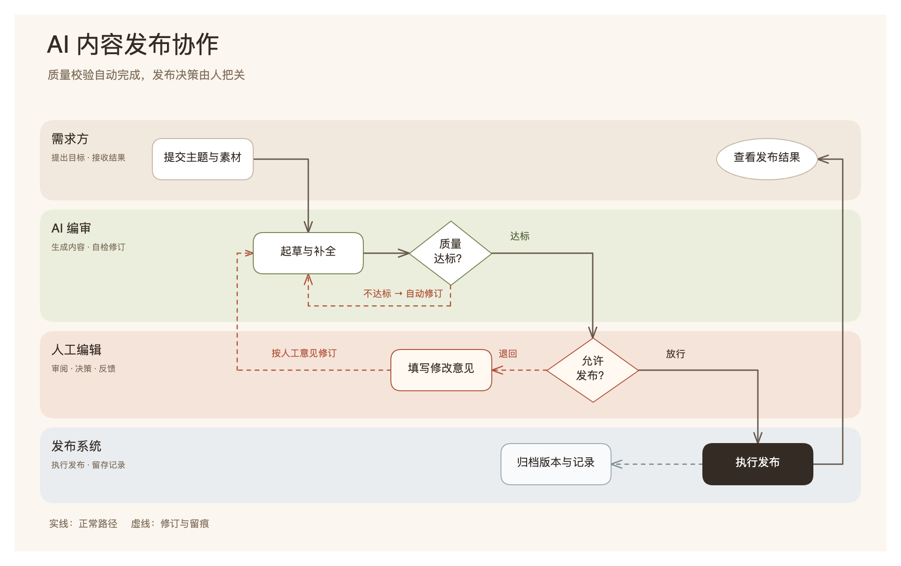
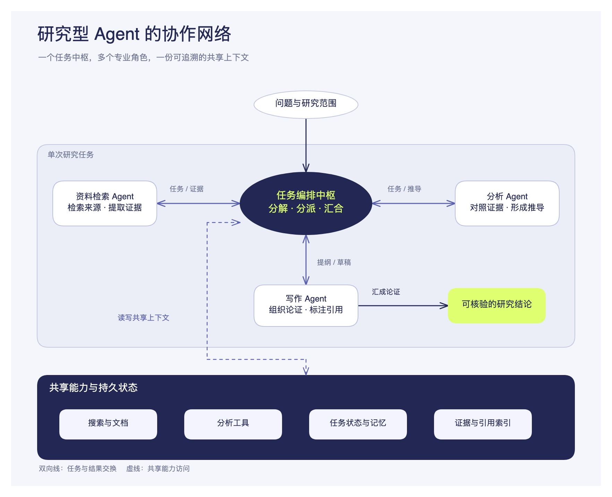

# Prompt to Canvas

[简体中文](README.md) | [English](README.en.md)

**Turn text into clear, polished Excalidraw canvases you can keep editing.**

A skill for AI agents such as Codex and Claude Code. Provide content and a purpose; the agent interprets the relationships, designs the composition and visual direction, and opens the result in a bundled local editor.

[Get started](#install) · [Examples and source files](docs/EXAMPLES.md) · [Visual references](src/skills/prompt-to-canvas/CATALOG.md)

## See the results

These conceptual examples are actual editor exports, not customer deployments. Their canvas text is Chinese. Click either image for context, SVG sources and editable scenes.

**Business process: responsibility lanes, decisions and revision loops**

[](docs/EXAMPLES.md)

**System architecture: central coordination, specialists and shared capabilities**

[](docs/EXAMPLES.md)

## What it does

- **Content-led composition:** create processes, architectures, timelines, comparisons and concept maps. Combine lanes, branches, nested boundaries, feedback and detail views without fixed columns, node counts or aspect ratios.
- **Autonomous visual direction:** use 35 visual references or a coherent custom direction. When no style is specified, the agent chooses directly; brand, reference and series requirements can guide it.
- **Editable output:** preserve native Excalidraw text and shapes, with groups, container labels and arrow endpoint bindings.
- **Local delivery:** the bundled editor supports Chinese/English UI, browser autosave and PNG/SVG export. Ordinary use needs no frontend dependency installation.

## Install

Requires **Git, Node.js 20+**, and an agent that can read skill files and execute local commands. These commands use a macOS/Linux shell.

```bash
git clone https://github.com/Zimzheng/prompt-to-canvas.git
cd prompt-to-canvas
```

Choose the installation location for your agent:

**Codex**

```bash
mkdir -p ~/.codex/skills
cp -R src/skills/prompt-to-canvas ~/.codex/skills/
sh ~/.codex/skills/prompt-to-canvas/scripts/preflight.sh
```

**Claude Code**

```bash
mkdir -p ~/.claude/skills
cp -R src/skills/prompt-to-canvas ~/.claude/skills/
sh ~/.claude/skills/prompt-to-canvas/scripts/preflight.sh
```

A successful check prints `Prompt to Canvas preflight OK`. Start a new agent session and name `prompt-to-canvas`. Back up any locally modified skill files before updating.

## Use

Provide content and purpose; style is optional. For example:

```text
Use prompt-to-canvas to draw an AI editorial workflow.
Include a requester, AI editor, human editor and publishing system.
Show automatic checks, human approval, revision requests and publication records.
Use English canvas text.
```

The agent designs the composition, selects a visual direction, generates and inspects the canvas, and provides a local editor link. It asks only when missing information materially affects correctness. Explicitly request visual options or multiple variants when useful.

```text
Content and purpose → Relationships and composition → Visual direction → SVG
                    → Editable scene → Local editing → PNG / SVG
```

Keep the editor process running to access its local link. Retain the generated SVG and scene JSON, and export the images you need; browser autosave is not a file backup.

## Limits and privacy

- The skill relies on an agent for analysis and composition; it is not a standalone diagram-generation service.
- The converter implements a defined SVG subset. Curves use editable sampled points and text bounds are estimates. Inspect actual rendering for text and complex routing; unsupported visible features produce errors.
- Automatic layout, obstacle avoidance, built-in PDF export and multiplayer collaboration are not integrated. See the [conversion contract](src/skills/prompt-to-canvas/RULES.md) for supported features.
- The editor runs over local HTTP and autosaves in browser `localStorage`. Content sent to the agent remains subject to your model provider's and runtime's data policies.

## Develop and validate

Rule and converter checks need Node on PATH, without frontend dependency installation:

```bash
npm test
npm run preflight
```

Install dependencies and rebuild the bundled runtime only when changing the editor:

```bash
npm ci
npm run dev
# After editing, build and synchronize the skill runtime
npm run build:skill
```

Editor source lives in `src/editor/`; the distributable skill lives in `src/skills/prompt-to-canvas/`. Tests cover conversion behavior and do not replace semantic or visual review. Contributions are welcome through [Issues](https://github.com/Zimzheng/prompt-to-canvas/issues) and Pull Requests.

## Documentation

[Skill workflow](src/skills/prompt-to-canvas/SKILL.md) · [Visual references](src/skills/prompt-to-canvas/CATALOG.md) · [Conversion capabilities and limits](src/skills/prompt-to-canvas/RULES.md) · [Example sources](docs/EXAMPLES.md) · [Release guide](docs/RELEASE.md) · [Security policy](SECURITY.md)

## Sources and license

The visual style library and preview assets derive from [Zara Zhang's beautiful-feishu-whiteboard](https://github.com/zarazhangrui/beautiful-feishu-whiteboard). This project adapts that foundation to a local Excalidraw workflow, extending content-led composition, SVG conversion, editing relationships and scene validation. Excalidraw supplies the editing engine.

[MIT licensed](LICENSE). The [upstream license](src/skills/prompt-to-canvas/LICENSE.beautiful-feishu-whiteboard) and attribution are preserved; see [NOTICE.md](NOTICE.md) for third-party sources and dependencies.
