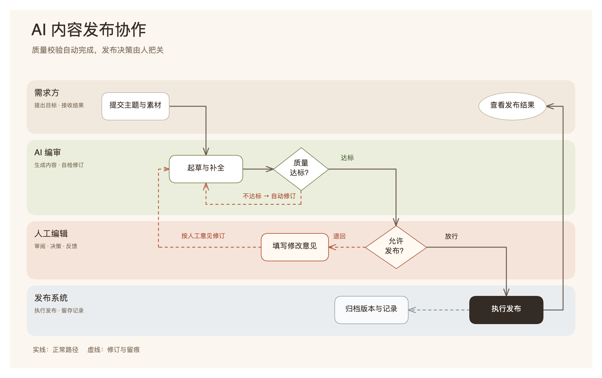
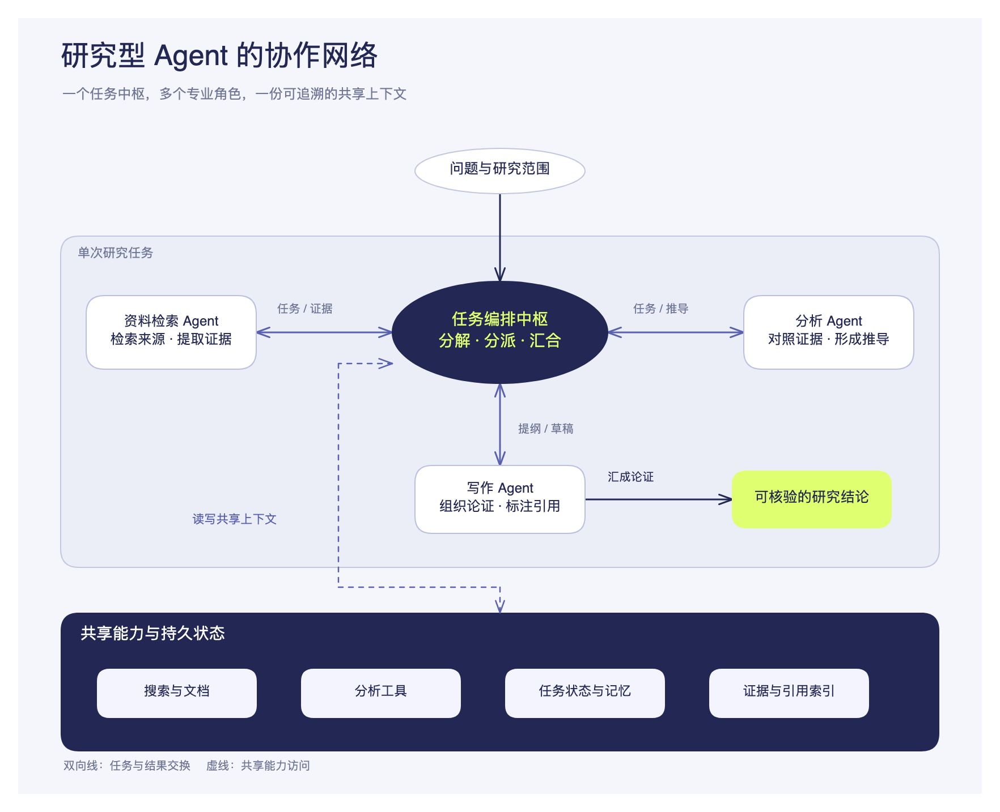

# Prompt to Canvas

[简体中文](README.md) | [English](README.en.md)

**把文字内容变成清晰、美观、可以继续编辑的 Excalidraw 画布。**

这是供 Codex、Claude Code 等 AI Agent 使用的技能。你提供内容与用途，Agent 负责理解关系、设计构图和视觉风格，再在内置本地编辑器中打开结果。

[安装使用](#安装) · [查看示例与源文件](docs/EXAMPLES.md) · [浏览视觉参考](src/skills/prompt-to-canvas/CATALOG.md)

## 看看效果

以下为概念示例，图片来自实际编辑器导出，并非客户部署。点击图片查看说明、SVG 源文件与可编辑场景。

**业务流程：角色泳道、条件分支与修订回路**

[](docs/EXAMPLES.md)

**系统架构：中心编排、专业角色与共享能力**

[](docs/EXAMPLES.md)

## 能做什么

- **按内容构图**：制作流程、架构、时间线、对比和概念关系图；可组合泳道、分支、嵌套边界、反馈与局部展开，不固定分栏、节点数或比例。
- **自主选择风格**：参考 35 种视觉语言或定义协调的自定义方向。未指定风格时直接选择；也可遵循品牌、参考图和系列要求。
- **继续编辑**：文字与形状保留为 Excalidraw 原生元素，支持分组、标签和箭头端点绑定。
- **本地交付**：内置编辑器支持中英文切换、浏览器自动保存和 PNG/SVG 导出，普通使用无需安装前端依赖。

## 安装

需要 **Git、Node.js 20+**，以及能够读取技能文件、执行本地命令的 Agent。以下命令适用于 macOS/Linux shell。

```bash
git clone https://github.com/Zimzheng/prompt-to-canvas.git
cd prompt-to-canvas
```

选择对应的安装位置：

**Codex**

```bash
mkdir -p ~/.codex/skills
cp -R src/skills/prompt-to-canvas ~/.codex/skills/
sh ~/.codex/skills/prompt-to-canvas/scripts/preflight.sh
```

**Claude Code**

```bash
mkdir -p ~/.claude/skills
cp -R src/skills/prompt-to-canvas ~/.claude/skills/
sh ~/.claude/skills/prompt-to-canvas/scripts/preflight.sh
```

预检成功会输出 `Prompt to Canvas preflight OK`。随后在 Agent 中开启新会话并指定 `prompt-to-canvas`。更新前请备份自己修改过的技能文件。

## 使用

告诉 Agent 内容和用途即可，风格可选。例如：

```text
使用 prompt-to-canvas，画一张 AI 内容发布协作流程图。
包含需求方、AI 编审、人工编辑和发布系统。
表现自动校验、人工放行、退回修改和发布留痕，文字使用中文。
```

Agent 会按内容设计构图、选择视觉方向，生成并检查画布，再提供本地编辑器链接。只有缺少影响正确性的关键信息时才追问。需要先比较视觉方向或生成多个方案时，可以明确提出。

```text
内容与用途 → 关系与构图 → 视觉风格 → SVG
          → 可编辑场景 → 本地编辑 → PNG / SVG
```

保持编辑器进程运行才能访问本地链接。请保留生成的 SVG 和场景 JSON，并导出需要的图片；浏览器自动保存不能替代文件备份。

## 使用边界与隐私

- 技能依赖 Agent 分析和构图，不是独立的图表生成服务。
- 转换器支持明确的 SVG 子集；曲线是可编辑采样点，文字尺寸是估算。复杂连线和文字需要实际渲染检查，不支持的可见特性会报错。
- 当前没有自动布局、自动避障、内置 PDF 导出或多人协作。完整支持范围见[转换能力说明](src/skills/prompt-to-canvas/RULES.md)。
- 编辑器通过本地 HTTP 运行，并在浏览器 `localStorage` 自动保存。提交给 Agent 的内容仍受所用模型服务和运行环境的数据策略约束。

## 开发与验证

规则和转换器检查只需要 Node 在 PATH 中，无需安装前端依赖：

```bash
npm test
npm run preflight
```

修改编辑器时，才需要安装依赖、启动开发环境并同步构建产物：

```bash
npm ci
npm run dev
# 修改完成后构建并同步到技能包
npm run build:skill
```

编辑器源码位于 `src/editor/`，可分发技能位于 `src/skills/prompt-to-canvas/`。测试覆盖转换行为，不能代替生成结果的语义与视觉检查。欢迎通过 [Issues](https://github.com/Zimzheng/prompt-to-canvas/issues) 或 Pull Request 反馈和改进。

## 文档

[技能工作流](src/skills/prompt-to-canvas/SKILL.md) · [视觉参考](src/skills/prompt-to-canvas/CATALOG.md) · [转换能力与限制](src/skills/prompt-to-canvas/RULES.md) · [示例源文件](docs/EXAMPLES.md) · [发布指南](docs/RELEASE.md) · [安全政策](SECURITY.md)

## 来源与许可证

视觉风格库和预览素材源自 [Zara Zhang 的 beautiful-feishu-whiteboard](https://github.com/zarazhangrui/beautiful-feishu-whiteboard)。本项目在其基础上适配本地 Excalidraw 工作流，扩展内容驱动构图、SVG 转换、编辑关联与场景校验；编辑能力由 Excalidraw 提供。

采用 [MIT 许可证](LICENSE)。保留了[上游许可证](src/skills/prompt-to-canvas/LICENSE.beautiful-feishu-whiteboard)与署名；第三方来源和依赖说明见 [NOTICE.md](NOTICE.md)。
