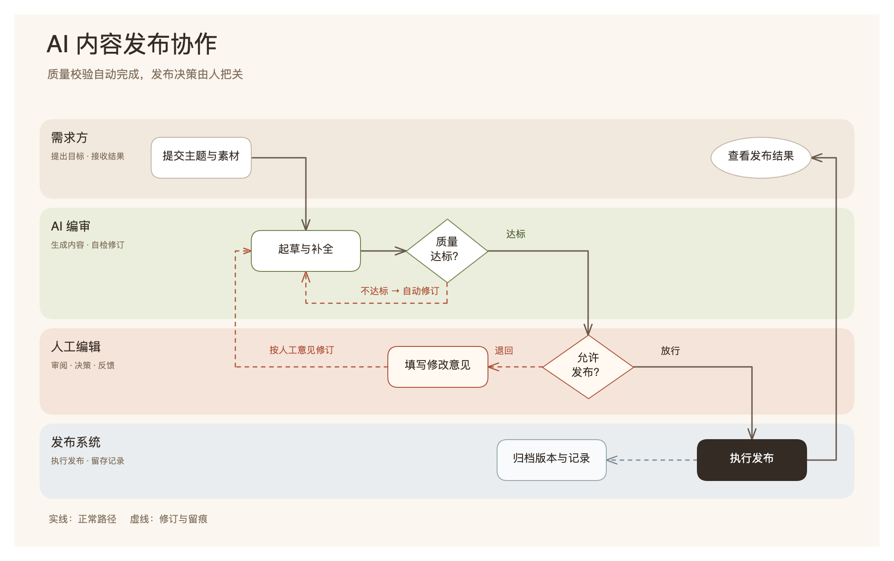
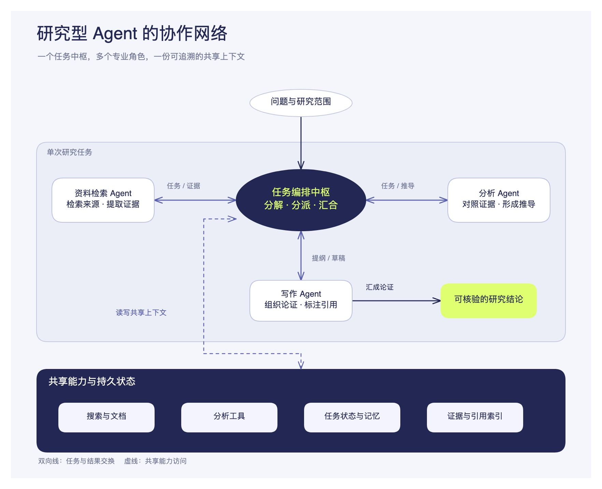

# Content-led canvas examples / 内容驱动的画布示例

Generated with v1.2.0 without specifying a style. These are conceptual demonstrations, not diagrams
of deployed systems or additional fixed templates. Each output uses native editable shapes and text.
Actual editor exports were inspected, with representative node movement, label following and undo
checked. These samples do not establish a statistical improvement in model output diversity.

## AI 内容发布协作 / AI editorial workflow

Warm responsibility lanes separate the requester, AI editor, human editor and publishing system.
Quality failures and manual rejections have distinct return routes; successful publication produces
both a visible result and an archive record.

[Editable scene](examples/case-1-editorial-workflow.excalidraw) · [SVG source](examples/case-1-editorial-workflow.svg)

## 研究型 Agent 协作网络 / Research agent collaboration

A central coordinator exchanges tasks and results with retrieval, analysis and writing agents.
A separate shared-capability boundary holds search, tools, task state and evidence references.
The indigo/lime visual direction and hub composition differ from the editorial workflow.

[Editable scene](examples/case-2-agent-network.excalidraw) · [SVG source](examples/case-2-agent-network.svg)

Open scenes in Excalidraw or with the bundled `open-editor.mjs`; PNGs above are actual editor exports.
Keep sources as editable references. Do not copy their node count, layout or sample wording into
unrelated generation tasks.
